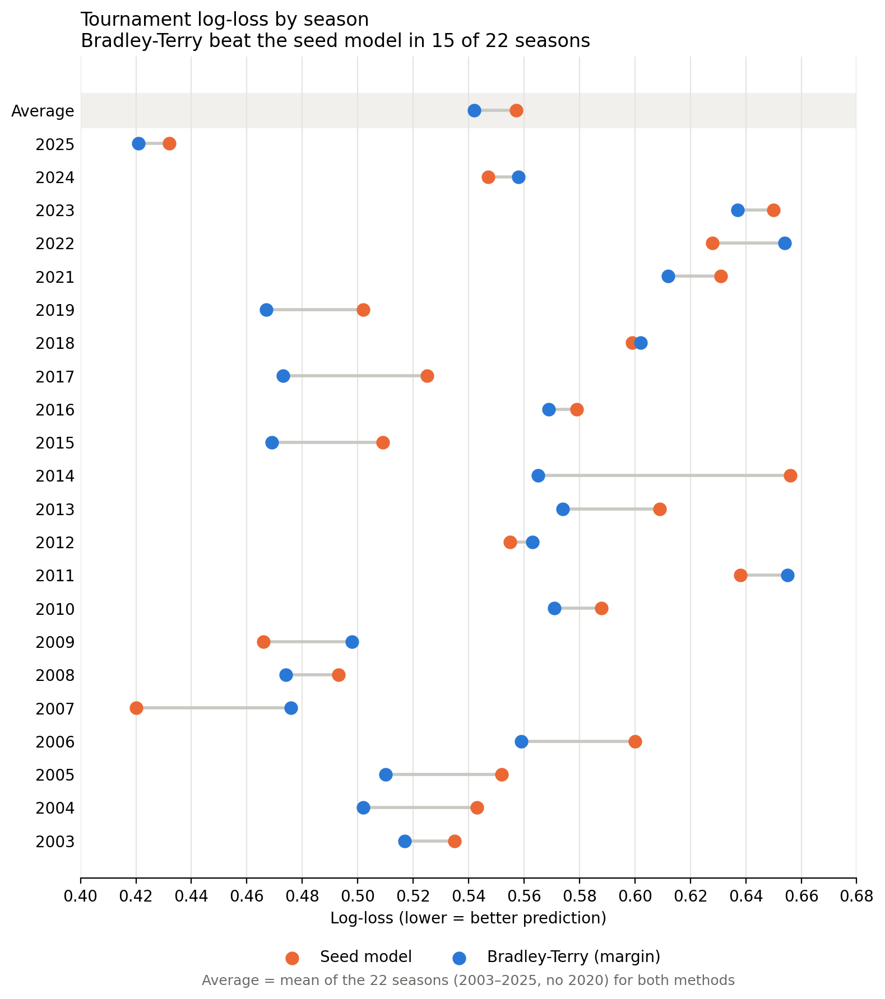
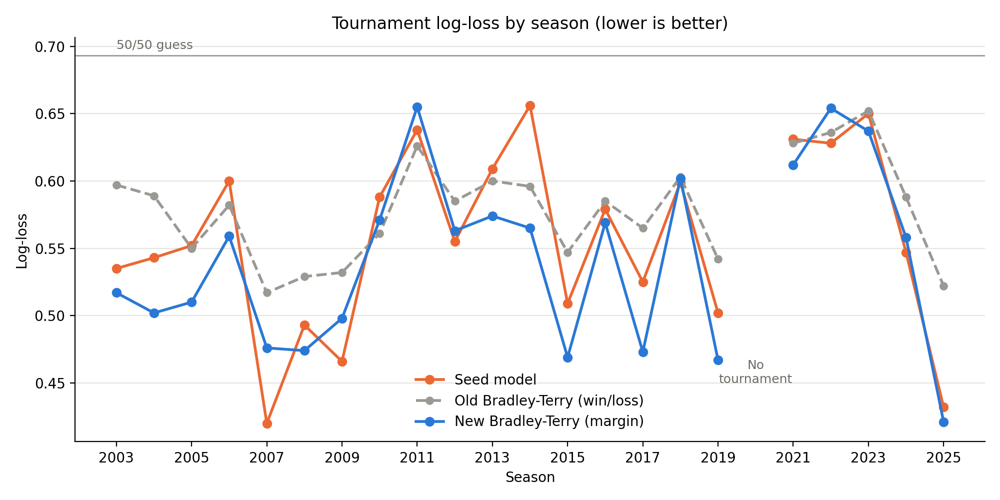
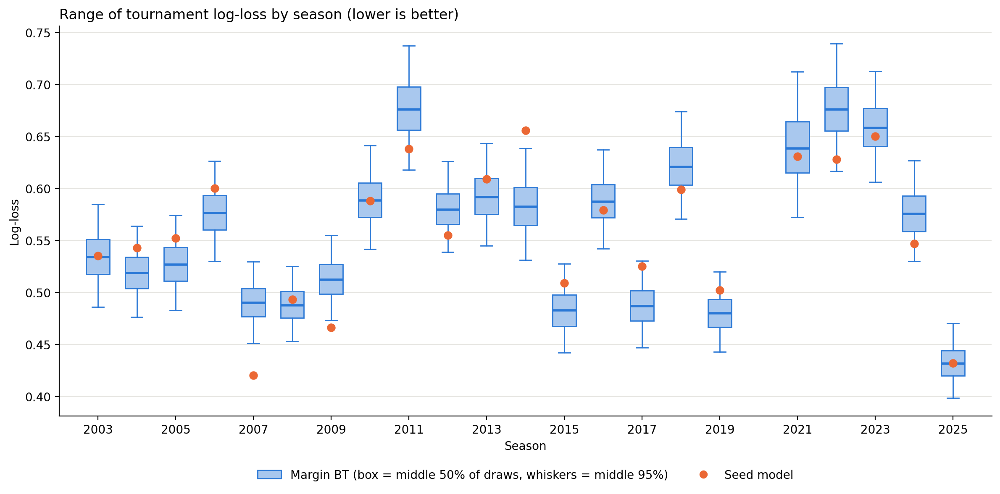
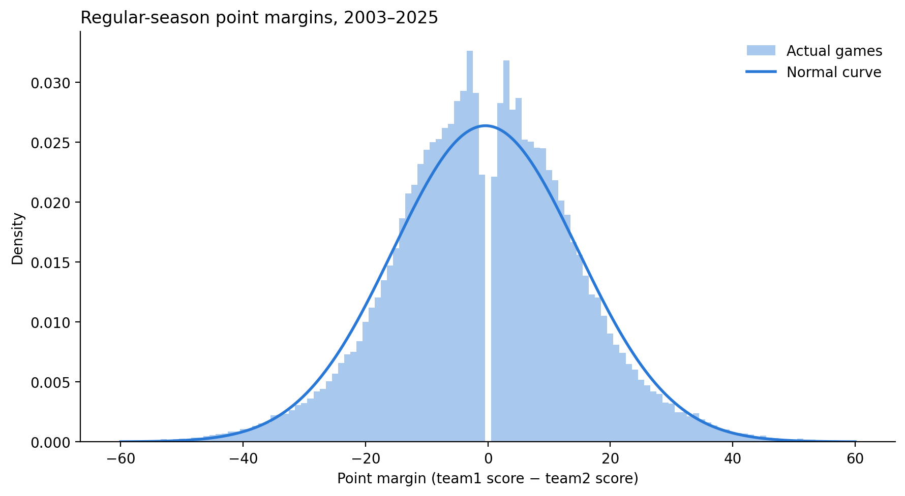
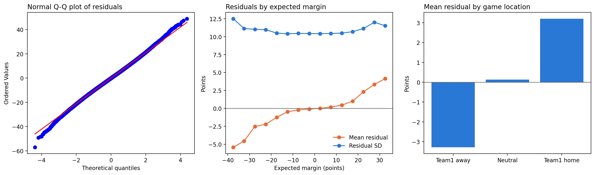

# NCAA Tournament Prediction — Bayesian Bradley–Terry (Margin Model)

Predicting NCAA men's tournament games with a Bayesian rating model fit on regular-season point margins, backtested across 22 tournaments (2003–2025) against a seed-based baseline.



## Results

Each model is fit **only on that season's regular-season games**, then scored on that season's tournament (First Four excluded). That gives 1,385 games across 22 seasons, with no tournament data leaking into the ratings.

| Model | Avg log-loss ↓ | Avg Brier ↓ | Beat seed baseline |
|---|---|---|---|
| Seed baseline (`p = opp_seed / (seed + opp_seed)`) | 0.557 | 0.189 | — |
| Bradley–Terry, win/loss only | 0.579 | — | 7 of 22 seasons |
| **Bradley–Terry, point margin** | **0.542** | **0.184** | **15 of 22 seasons** |

The win/loss version did worse than just using seeds. Switching to point margin used the information each game carries beyond who won, and that turned it into a model that beats the seed baseline in most seasons.

## Model

For each season, every team gets a latent strength θ:

```
expected_margin = θ[team1] − θ[team2]
margin          ~ Normal(expected_margin, σ)

θ ~ ZeroSumNormal(σ = 10)      # ratings centered at 0
σ ~ HalfNormal(15)             # game-to-game noise, ~11 pts in practice
```

Win probability for a matchup is `P(A beats B) = Φ((θ_A − θ_B) / σ)`, averaged over all 4,000 posterior draws, so rating uncertainty carries into the prediction.

Fit with PyMC (NUTS, 4 chains × 1,000 draws). Every season converged: max R-hat ≤ 1.008, zero divergences, bulk ESS > 3,400 ([diagnostics](results/bt_margin_diagnostics.csv)).

## Figures

| | |
|---|---|
|  |  |
| Log-loss by season, all three models | Posterior range of log-loss per season vs. seed |
|  |  |
| Regular-season margins vs. Normal fit | Residual diagnostics |

## Limitations

- **No home-court term.** Regular-season home advantage gets absorbed into team ratings. Tournament games are on neutral courts, so this mostly adds noise.
- **Static within a season.** A team's November form counts the same as its March form.
- **Normal likelihood.** Margins have slightly heavier tails than a Normal (blowouts), visible in the residual plot.
- **Pre-tournament ratings only.** Ratings aren't updated between tournament rounds.

## Run it

```bash
pip install -r requirements.txt
```

1. Download the [Kaggle March Machine Learning Mania 2026](https://www.kaggle.com/competitions/march-machine-learning-mania-2026/data) data and put the CSVs in `data/`. The data isn't redistributed here.
2. Open `bradley_terry_margin.ipynb` and run all cells. The full 22-season backtest takes about a minute.

Outputs (CSVs and figures) are written to `results/`.

## Stack

Python · PyMC · ArviZ · NumPy · pandas · SciPy · Matplotlib

Developed as part of a data science capstone at the University of Colorado Boulder.
